<a href="https://ssquaredlabs.dev">
  
</a>

<p align="center">
  <a href="https://ssquaredlabs.dev"></a>
  <a href="https://apify.com/saksham_dev"></a>
  <a href="https://github.com/Saksham27?tab=repositories"></a>
  
</p>

<br />


I’m a software engineer from India who likes turning small, annoying problems into products that run themselves.
By day I build backend systems in **.NET** and **Node.js**. The rest of the time I run **[SSquared Labs](https://ssquaredlabs.dev)**,
a one-person studio that ships focused tools people are already searching for, and automates everything around them.

```text
▸ currently   shipping data tools on the Apify Store and extensions on the Chrome Web Store
▸ exploring   Rust, e-invoicing standards (XRechnung, ZUGFeRD, Peppol, KSeF), AI document pipelines
▸ believes    the best product is the one that keeps working while you sleep
```

<br />


<p align="center">
  <a href="https://ssquaredlabs.dev"></a>
  <a href="https://apify.com/saksham_dev"></a>
</p>
<p align="center">
  <a href="https://ssquaredlabs.dev/products/contact-finder-extension/"></a>
  <a href="https://ssquaredlabs.dev/products/budget-finance-india/"></a>
</p>

<br />


<p align="center">
  <br />
  
</p>

<br />


<p align="center">
  
  
</p>

<p align="center">
  <picture>
    <source media="(prefers-color-scheme: dark)" srcset="https://raw.githubusercontent.com/Saksham27/Saksham27/output/snake-dark.svg" />
    
  </picture>
</p>

<br />

<a href="https://ssquaredlabs.dev"></a>
